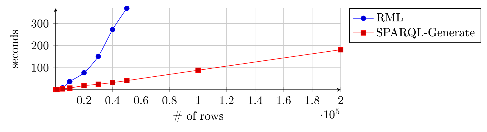
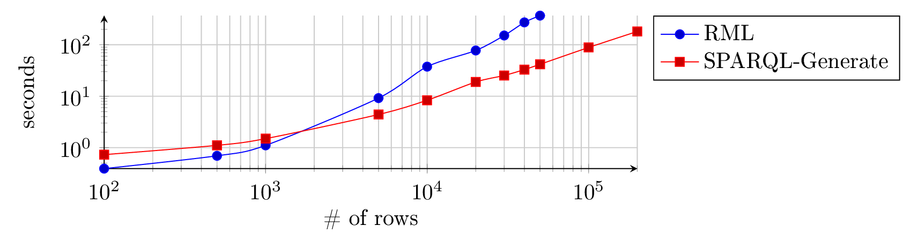

# Evaluation of 2017

!!! note "Archived page"
    This comparison was made in 2016-2017 for the ESWC 2017 paper, with version 1.x of the engine and the RML Processor of that time. It does not describe the current engines.

The evaluation compares the reference implementations of SPARQL-Generate and RML at the time, `sparql-generate-jena` and `RML-Processor`, on a simple transformation from CSV documents to RDF.

## Documents

CSV documents generated by GenerateData.com. For example, [persons.csv](https://ci.mines-stetienne.fr/sparql-generate/evaluation/1/persons.csv) has 100 rows. The archive [documents.zip](https://ci.mines-stetienne.fr/sparql-generate/evaluation/1/documents.zip) contains documents of 100, 1,000, 5,000, 10,000, 20,000, 30,000, 40,000, 50,000, 100,000 and 200,000 rows.

## Transformation

For each row, a few triples with the same subject, constant predicates, and objects computed from one column. [persons.ttl](https://ci.mines-stetienne.fr/sparql-generate/evaluation/1/persons.ttl) is the graph expected for the document of 100 rows. The transformation is written as a SPARQL-Generate query, [simple.rqg](https://ci.mines-stetienne.fr/sparql-generate/evaluation/1/simple.rqg), and as an RML mapping, [simple.ttl](https://ci.mines-stetienne.fr/sparql-generate/evaluation/1/simple.ttl).

## Experiment

The Java project [project.zip](https://ci.mines-stetienne.fr/sparql-generate/evaluation/1/project.zip) measures the duration of the transformation of each document with both engines; its `readme.md` explains how to reproduce the experiment.

## Results

For this transformation, `sparql-generate-jena` was faster than `RML-Processor` above about 1,500 rows, and its duration grew linearly: slightly above 3 minutes for 20,000 rows, when `RML-Processor` took more than 6 minutes for 5,000 rows. A comparison of implementations does not measure the approaches themselves: optimisations and the choice of libraries change the results.
